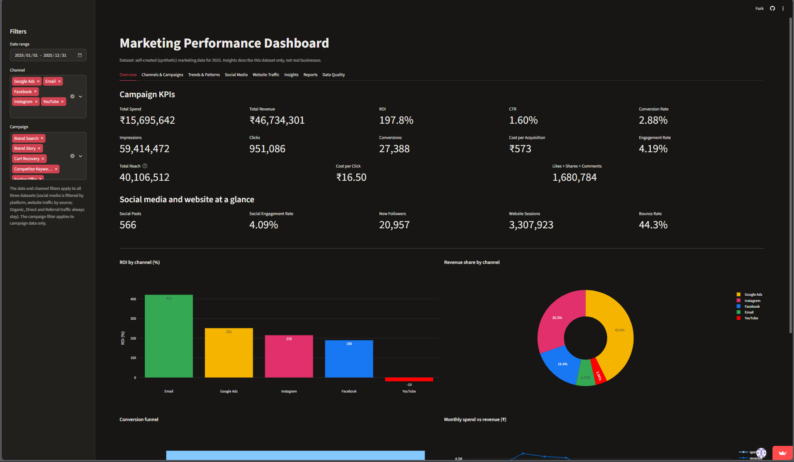
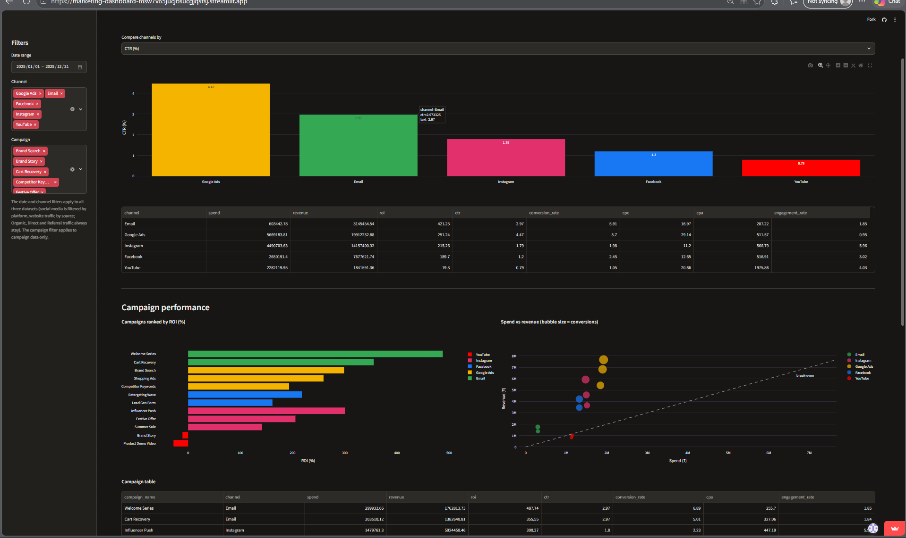
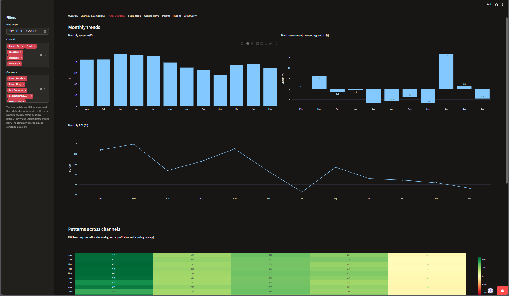

# Marketing Performance Dashboard

A data analytics project that tracks, analyses and visualises marketing campaign performance across five channels (Instagram, Facebook, Google Ads, Email and YouTube). It was built as the Data Analytics Capstone Project for SkillOrbit.

**Live dashboard:** [PASTE YOUR STREAMLIT LINK HERE]



## About the project

The dashboard helps a business see which campaigns and channels give the best return. It cleans raw marketing data, calculates the main marketing KPIs, shows them in an interactive dashboard, writes business insights automatically and produces downloadable reports.

**Note on the data:** all three datasets are **self-created (synthetic)**, generated with the Python scripts in this repo (the project brief allows self-created datasets). Realistic differences between channels were built in, and deliberate quality problems (duplicates, missing values, wrong names, impossible values) were added so the cleaning step has real work to do. The insights therefore describe this dataset only and are not claims about real businesses.

## Features

- **Overview:** campaign KPIs (spend, revenue, ROI, CTR, conversion rate, CPA, engagement rate, reach), ROI by channel, revenue share, conversion funnel, monthly spend vs revenue
- **Channels and campaigns:** channel comparison on a selectable metric, campaigns ranked by ROI, spend vs revenue bubble chart, ad-click-to-website-visit funnel
- **Trends and patterns:** monthly revenue, month-over-month growth, month x channel ROI heatmap, engagement trend by channel
- **Social media:** engagement by post type and platform, reach vs engagement for every post, top posts
- **Website traffic:** sessions by source, bounce rate, session duration
- **Insights:** findings and recommendations generated automatically from the filtered data
- **Reports:** campaign report, marketing summary and monthly analytics report (Excel, CSV and Markdown downloads)
- **Data quality:** raw vs cleaned row counts and the cleaning steps
- **Filters:** date range, channel and campaign, applied across all tabs

## Datasets

| Dataset | What it holds | Raw rows | Clean rows |
|---|---|---|---|
| Campaigns | Daily spend, impressions, clicks, conversions, revenue and engagement for 12 campaigns (2025) | 4,460 | 4,346 |
| Social media | One row per post: reach, likes, comments, shares, saves, link clicks, new followers | 584 | 566 |
| Website traffic | Daily sessions, bounce rate and session duration for 8 traffic sources | 2,950 | 2,910 |

Paid-source website sessions are derived from the campaign click data, so the datasets agree with each other and can be linked by date and channel.

## KPI formulas

| KPI | Formula |
|---|---|
| CTR | clicks / impressions x 100 |
| Conversion rate | conversions / clicks x 100 |
| CPC | spend / clicks |
| CPA | spend / conversions |
| ROI | (revenue - spend) / spend x 100 |
| Engagement rate | (likes + shares + comments) / reach x 100 |

KPIs are calculated by summing the raw numbers first and then dividing, never by averaging row-level percentages. Website averages (bounce rate, session duration) are weighted by sessions.

## Tech stack

- Python, Pandas, NumPy
- Plotly (interactive charts)
- Streamlit (dashboard)
- SQLite (database)
- openpyxl (Excel export)
- GitHub and Streamlit Community Cloud (deployment)

## Project structure

```
marketing-dashboard/
├── app.py                      # Streamlit dashboard
├── marketing.db                # SQLite database
├── requirements.txt
├── data/
│   ├── raw/                    # generated raw CSV files
│   └── cleaned/                # cleaned CSV files
├── src/
│   ├── generate_data.py        # creates the campaign dataset
│   ├── clean_data.py           # cleans the campaign dataset
│   ├── generate_extra_data.py  # creates social media and website traffic datasets
│   ├── clean_extra_data.py     # cleans those two datasets
│   ├── load_to_sqlite.py       # loads all cleaned data into marketing.db
│   ├── kpis.py                 # KPI functions
│   ├── check_kpis.py           # checks the KPIs against manual calculations
│   ├── insights.py             # generates insights and recommendations
│   └── reports.py              # builds the downloadable reports
└── screenshots/
```

## How to run it

1. Install Python 3.9 or newer.
2. Clone the repository and install the libraries:

```
git clone [PASTE YOUR GITHUB LINK HERE]
cd marketing-dashboard
pip install -r requirements.txt
```

3. Start the dashboard (the data and database are already in the repo):

```
streamlit run app.py
```

### Rebuilding the data from scratch (optional)

Run the scripts from the project folder in this order:

```
python src/generate_data.py
python src/clean_data.py
python src/generate_extra_data.py
python src/clean_extra_data.py
python src/load_to_sqlite.py
python src/check_kpis.py
```

`check_kpis.py` recalculates some KPIs by hand and compares them with the functions in `kpis.py`. It should finish with `All extra checks passed!`.

## Data cleaning

Each raw file goes through the same steps:

1. Convert dates to a proper date type
2. Standardise inconsistent names (for example `insta`, `FB`, `Google_Ads`)
3. Remove duplicate rows
4. Fill missing numbers with the median of the same campaign, platform or source
5. Remove impossible rows: negative spend, clicks above impressions, bounce rate above 100%, likes above reach
6. Check that no missing values or duplicates remain

| | Campaigns | Social media | Website traffic |
|---|---|---|---|
| Rows at start | 4,460 | 584 | 2,950 |
| Duplicates removed | 80 | 12 | 30 |
| Impossible rows removed | 34 | 6 | 10 |
| Rows at end | 4,346 | 566 | 2,910 |

## Sample findings (in this dataset)

- Email has the highest ROI (about 421%) and the lowest cost per acquisition
- Google Ads has the best click-through rate and the largest revenue
- YouTube loses money (ROI about -19%)
- Instagram has the highest engagement, and Reels are its best format
- Organic Search is the largest source of website traffic (about 40% of sessions)

## Screenshots

| | |
|---|---|
|  |  |
|  |  |

## Limitations

- The data is synthetic, so the results illustrate the method and are not evidence about real markets
- "Total reach" adds daily reach figures, so one person can be counted more than once
- The analysis shows associations and does not prove cause and effect
- There is no prediction or real-time data, in line with the project scope

## Author

[YOUR NAME]
[Course / batch]
